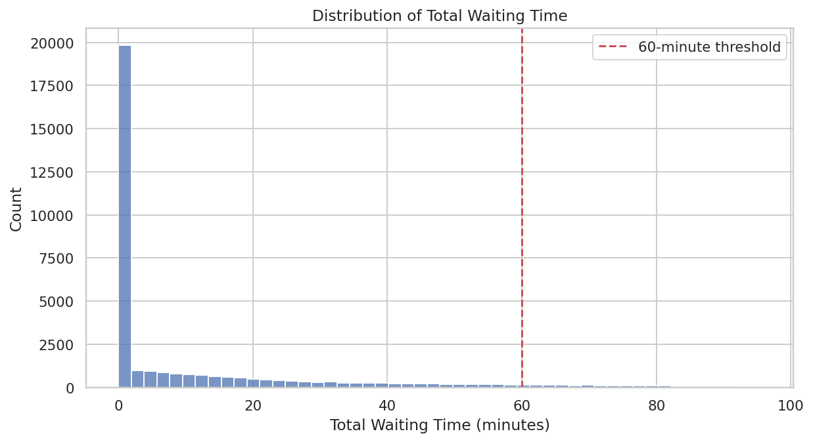
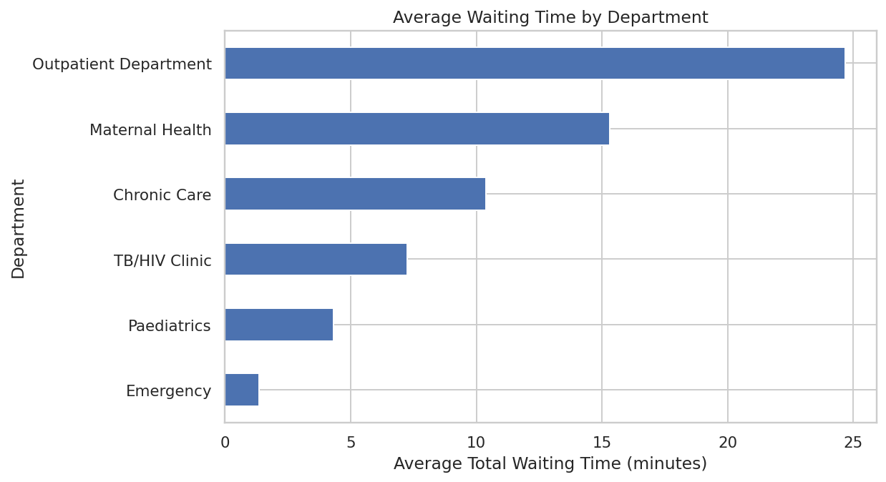
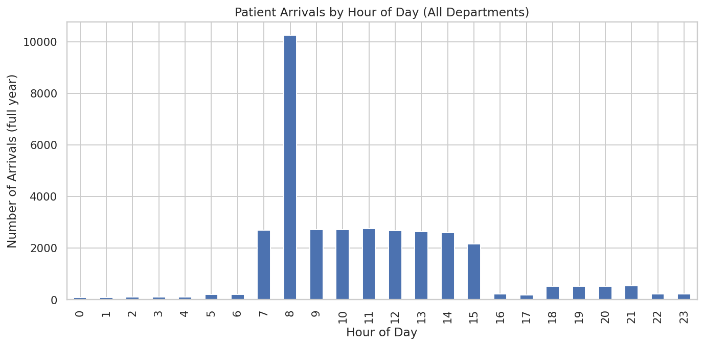
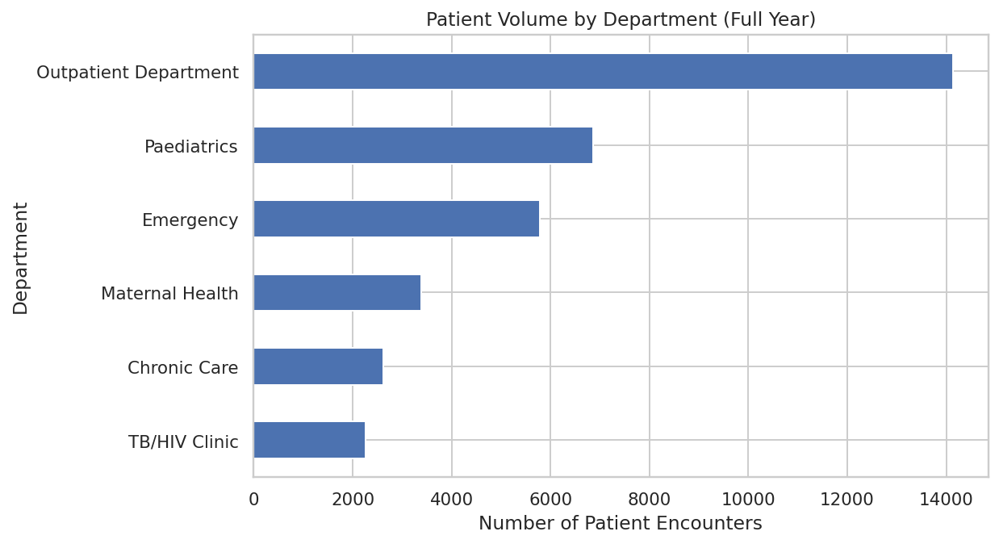

# Hospital Operations Analytics & Workforce Planning

<p align="center">
  <strong>Patient flow • Workforce coverage • Bottleneck analysis • MWK resource planning</strong>
</p>

<p align="center">
  <a href="https://hospital-operations-command-centre.streamlit.app/"><strong>▶ Open the live Hospital Operations Command Centre</strong></a>
  &nbsp;•&nbsp;
  <a href="docs/PORTFOLIO_CASE_STUDY.md">Read the portfolio case study</a>
  &nbsp;•&nbsp;
  <a href="docs/DASHBOARD_USER_GUIDE.md">Dashboard user guide</a>
</p>

<p align="center">
  <a href="https://github.com/MkandawireChico/Hospital-Patient-Flow-Analysis/actions/workflows/quality.yml"></a>
  <a href="https://hospital-operations-command-centre.streamlit.app/"></a>
  
  
</p>

> **Explore the deployed application:** [hospital-operations-command-centre.streamlit.app](https://hospital-operations-command-centre.streamlit.app/). The dashboard brings patient-flow analytics, workforce coverage, role-based establishment and MWK budget planning into one interactive command centre.

## Visual preview

The charts below are reproducible analysis outputs from the repository. The live application adds interactive filters, patient-flow drill-downs, workforce and roster analytics, shift coverage, capacity sensitivity, and an MWK staffing budget planner.

<p align="center">
  <a href="https://hospital-operations-command-centre.streamlit.app/"><strong>Open the interactive command centre →</strong></a>
</p>

<table>
  <tr>
    <td width="50%">
      <strong>Waiting-time distribution</strong><br>
      
    </td>
    <td width="50%">
      <strong>Department-level waiting times</strong><br>
      
    </td>
  </tr>
  <tr>
    <td width="50%">
      <strong>Arrival patterns</strong><br>
      
    </td>
    <td width="50%">
      <strong>Patient volumes</strong><br>
      
    </td>
  </tr>
</table>

*These are static analytical chart exports; use the live application for interactive exploration and the Workforce & Roster page.*

## At a glance

| Area | What the project delivers |
|---|---|
| Patient-flow analytics | Waiting-time KPIs, department and service-stage bottlenecks, arrival patterns and long-wait analysis |
| Workforce analytics | Staff establishment, role mix, date-aligned shift rosters and demand-to-workforce views |
| Decision support | Transparent what-if scenarios, capacity sensitivity and role-based staffing budgets in MWK |
| Predictive analytics | Leakage-conscious logistic-regression baseline for long-wait classification |
| Data quality | Auditable timestamp checks, wait validation, exclusions and downloadable filtered data |
| Engineering | Reproducible Python workflow, modular source code, automated tests and lint checks |

**Technology:** Python, pandas, NumPy, Streamlit, Plotly, scikit-learn, pytest and Ruff.

---
This project examines patient flow and workforce operations in a Malawi-inspired district-hospital case study. It asks: **Where do patients lose time in the hospital pathway, how does demand align with staffing, and which operational changes merit further investigation?** The repository provides a reproducible Python workflow for data quality, operational analysis, scenario comparison, workforce planning, predictive modelling and decision-ready visualisation.

## Why this project exists

Patients move through connected stages such as registration, triage, consultation, laboratory, and pharmacy. Delays can accumulate at different points, so managers need to see where waiting concentrates before comparing operational responses. This project turns that question into auditable metrics and transparent scenario comparisons rather than assuming one intervention will work everywhere.

## Data provenance and interpretation

The repository uses generated case-study records and invented staff profiles to demonstrate the full analytical workflow; Chilungamo District Hospital is a case-study setting, not an identified operating facility. Findings and scenario outputs describe this dataset and its stated assumptions. They are not evidence of performance at a named hospital, clinical validation, causal estimates or staffing-safety recommendations. This provenance note is retained here and in the technical methods rather than repeated throughout the dashboard.

## Key findings

<!-- BEGIN GENERATED FINDINGS -->
- **Analysis cohort:** 34,728 of 35,082 processed rows; 354 rows were excluded for invalid timing or negative-wait evidence.
- **Overall valid wait:** median 0.0 min, mean 13.8 min, p90 48.2 min, and 7.1% above the 60-minute long-wait threshold.
- **Largest stage-wait signal:** Laboratory has a p90 of 182.9 min and contributes 68.7% of summed observed stage-wait minutes. This share is not a decomposition of total wait.
- **Department signal:** Outpatient Department has the highest department p90 total wait at 73.5 min.
- **Peak pattern:** median wait is 14.9 min during Peak versus 0.0 min during Non-Peak; p90 is 73.4 versus 20.7 min. These are group comparisons, not evidence that the period label causes delay.
- **Priority pattern:** Routine: p90 54.4 min, Urgent: p90 41.6 min, Emergency: p90 10.8 min.
- **Strongest tested scenario:** Consultation wait reduction has p90 41.4 min versus baseline 48.2 min (6.8 min lower) and a 2.10-percentage-point lower long-wait share. Median wait remains 0.0 min across all scenarios, so the comparison is ranked on p90 and long-wait share rather than median alone.
<!-- END GENERATED FINDINGS -->

## Portfolio case study

See [`docs/PORTFOLIO_CASE_STUDY.md`](docs/PORTFOLIO_CASE_STUDY.md) for the employer-facing project story, selected case-study findings, methods, technical skills, limitations, and a concise CV-ready project description.

Additional technical documentation:
- [Project architecture](docs/ARCHITECTURE.md)
- [Dashboard user guide](docs/DASHBOARD_USER_GUIDE.md)
- [Analytical methods and metric definitions](docs/ANALYTICAL_METHODS.md)
- [MWK costing guide](docs/MWK_COSTING_GUIDE.md)
- [Portfolio case study](docs/PORTFOLIO_CASE_STUDY.md)

## Project workflow

- **Encounter source:** start from the supplied case-study encounter file and its documented generation assumptions.
- **Cleaning and quality flags:** standardise departments, detect timing issues, flag negative waits, and preserve quality indicators.
- **Feature engineering:** derive arrival-hour, peak-period, long-wait, congestion, and month features.
- **Baseline analysis:** calculate overall, stage, department, peak-period, and priority-level metrics.
- **Scenario comparison:** compare the baseline with two consultation-wait interventions on the same valid analysis cohort.
- **Exports:** write result tables and a generated decision summary for review.

## Repository structure

```text
config/                 Simulation configuration
dashboard/              Power BI dashboard guide
data/raw/               Encounter source data
data/processed/         Cleaned and feature-engineered encounters
notebooks/              Exploratory analysis notebook
reports/                Generated decision summary
results/                Generated baseline and scenario CSV tables
sql/                    SQLite schema, builder, queries, and notes
src/patient_flow/       Cleaning, features, analysis, scenarios, and CLI
tests/                  Pytest coverage
visuals/charts/         Analysis chart exports
Makefile                Common setup, test, lint, and run commands
pyproject.toml          Package and tool configuration
requirements.txt        Runtime and development dependencies
```

## Data

The encounter source is [`data/raw/hospital_patient_flow_synthetic.csv`](data/raw/hospital_patient_flow_synthetic.csv). The processed dataset is [`data/processed/hospital_patient_flow_clean.csv`](data/processed/hospital_patient_flow_clean.csv), which retains encounter rows and adds quality flags and analysis features.

<!-- BEGIN GENERATED DATA COUNTS -->
- Raw encounter source: **35,418 rows**.
- Processed dataset: **35,082 rows**.
- Valid analysis cohort: **34,728 rows**.
<!-- END GENERATED DATA COUNTS -->

The records include encounter and patient identifiers; visit dates and stage timestamps; department and priority; stage-specific waits and durations; queue size and service indicators; disposition and demographic categories; and quality flags. Laboratory and pharmacy timestamps or waits can be absent when an encounter did not use that stage; these fields are not treated as missing service events by default.

## Methods

- **Duplicates and departments:** remove exact duplicate rows, map known department aliases to canonical labels, and flag unrecognised department values rather than guessing.
- **Timestamp quality:** flag stage timestamps that precede arrival or an earlier recorded stage.
- **Negative waits:** flag rows with negative wait evidence. Cleaned wait fields are clipped at zero for safe representation, while flagged rows are excluded from wait analysis.
- **Valid total wait:** use `Total_Waiting_Time_Valid`, excluding rows flagged for impossible timing or negative waits. Encounters remain available for volume counts.
- **Long wait and congestion:** derive the long-wait flag from the documented threshold in the generated findings. Mark high congestion using the upper-quartile queue-size rule.
- **Baseline KPIs:** summarize mean, median, upper-tail wait, long-wait share, and length of stay overall and by relevant groups. Stage contribution is based on each stage's share of observed stage-wait minutes, not a decomposition of total wait.
- **Scenarios:** compare baseline with a consultation-wait reduction for Routine patients and a consultation-wait reduction for Urgent/Emergency patients during the recorded Peak period. Each intervention changes the targeted consultation component and corresponding valid total wait; other components remain unchanged.

Thresholds and flags are operational heuristics. Scenario reductions are assumed percentages implemented as what-if transformations. Neither establishes a real-world causal effect. All results depend on the documented case-study assumptions and available fields.

## Live deployment

The application is live on Streamlit Community Cloud:

**[Launch the Hospital Operations Command Centre](https://hospital-operations-command-centre.streamlit.app/)**

The deployed app uses this repository's `main` branch and `dashboard/app.py` entrypoint. See the [deployment guide](docs/DEPLOYMENT.md) for setup details and post-deployment checks.

## Interactive dashboard

The project includes a Streamlit command centre with interactive Plotly charts. It supports date, department, priority, visit-type, and disposition filters, and updates the KPI cards and visual analysis for the selected cohort.

### Dashboard views

- **Performance overview:** encounter volume, mean and median valid wait, 90th-percentile wait, and the share above the 60-minute threshold.
- **Wait distribution:** histogram with a box-plot marginal and the long-wait threshold.
- **Department bottlenecks:** department-level P90 waits with encounter-volume context.
- **Arrival pressure:** hourly encounter volume alongside P90 wait, plus monthly median/P90 trends.
- **Stage and priority analysis:** stage-specific P90 waits, observed stage-wait contribution, and priority comparisons.
- **What-if scenarios:** overall P90 and long-wait-share comparisons, plus department-level median changes.
- **Predictive baseline:** leakage-conscious logistic regression for the 60-minute long-wait target, with hold-out metrics, ROC curve, confusion matrix, and coefficient chart.
- **Data quality:** timestamp, negative-wait, department-label, and length-of-stay audit counts.
- **Filtered export:** inspect and download the filtered encounter cohort as CSV.

Run the dashboard from the repository root after installing the project dependencies and generating the processed dataset:

```bash
python -m pip install -r requirements.txt
python -m patient_flow.cli run
streamlit run dashboard/app.py
```

Alternatively, use `make dashboard` where Make is available. The dashboard reads `data/processed/hospital_patient_flow_clean.csv`; rerun the pipeline after changing the source data. Scenario comparisons are assumption-based what-if calculations, not causal estimates or operational forecasts.

### Budget planning in Malawi Kwacha (MWK)

For the costing method and input governance, see [the MWK costing guide](docs/MWK_COSTING_GUIDE.md) and [the editable assumptions template](config/mwk_staffing_cost_template.csv).

The Workforce & Roster page includes a role-based establishment budget planner: enter proposed additional FTE and locally verified fully loaded monthly costs by department and job title, record source/effective date, and export role-level and total budgets in **MWK**. The planner starts at zero and contains no unverified salary estimates or USD conversion. See [the MWK costing guide](docs/MWK_COSTING_GUIDE.md). The project also includes an optional long-wait classification model built with scikit-learn. The dashboard also offers optional 95% bootstrap confidence intervals for median wait, P90 wait, and long-wait share.

## Workforce and staff scheduling

The project includes a **40-person staff directory** and a reproducible 28-day shift roster covering clinical, nursing, laboratory, pharmacy, administration, community-health and support roles. The Workforce & Roster dashboard page explores staff mix, departmental establishment, shift coverage, scheduled hours, and demand-to-workforce alignment. Clinical demand is counted by encounter department; laboratory and pharmacy demand use recorded stage events, while registration-stage records map to Administration. Service-stage events are grouped by patient arrival shift as a clearly labelled timing proxy. Downloadable workforce and demand-coverage tables are included. A service-stage view compares observed consultation, laboratory, pharmacy and registration wait signals by workforce unit. A unit-level capacity sensitivity compares observed demand events per scheduled hour with user-configured additional FTE-hours and an MWK budget, using explicit assumptions rather than claiming a predicted wait-time effect. See [the workforce analytics guide](docs/WORKFORCE_ANALYTICS.md) and [the synthetic workforce data dictionary](docs/WORKFORCE_DATA_DICTIONARY.md). The workforce register is a generated case-study dataset; it is not a real HR register or a safe-staffing recommendation. No salaries are included; all cost assumptions remain configurable in MWK using verified local inputs.

Generate the roster from the staff directory with:

```bash
python -m patient_flow.workforce
```

## Power BI

[`dashboard/powerbi_dashboard_guide.md`](dashboard/powerbi_dashboard_guide.md) documents a dashboard design based on the processed data and generated outputs, including model considerations, measures, report views, and filters. It keeps case-study outputs distinct from evidence about operating clinical services.

## How to reproduce

From the repository root in PowerShell:

```powershell
py -m venv .venv
.\.venv\Scripts\Activate.ps1
python -m pip install -r requirements.txt
$env:PYTHONPATH = "src"
python -m patient_flow.cli run
```

The `run` command rebuilds the processed dataset, result CSVs, decision summary, and generated README findings. To regenerate analysis outputs from the existing processed dataset, run:

```powershell
python -m patient_flow.cli analyse
```

Run tests and lint checks with:

```powershell
python -m pytest -q
python -m ruff check .
```

The simulation seed and generation parameters are maintained in `config/default.yaml`. The CLI is implemented in `src/patient_flow/cli.py`; `make run`, `make analyse`, `make test`, and `make lint` provide the corresponding Make targets where Make is available.

## Author

Chico Mkandawire  
MSc Data Science, Malawi University of Science and Technology (in progress)  
BSc Management Information Systems, Malawi University of Business and Applied Sciences
